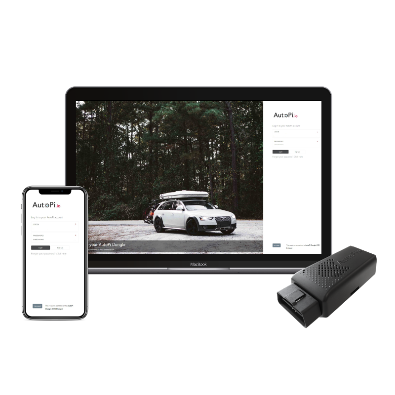
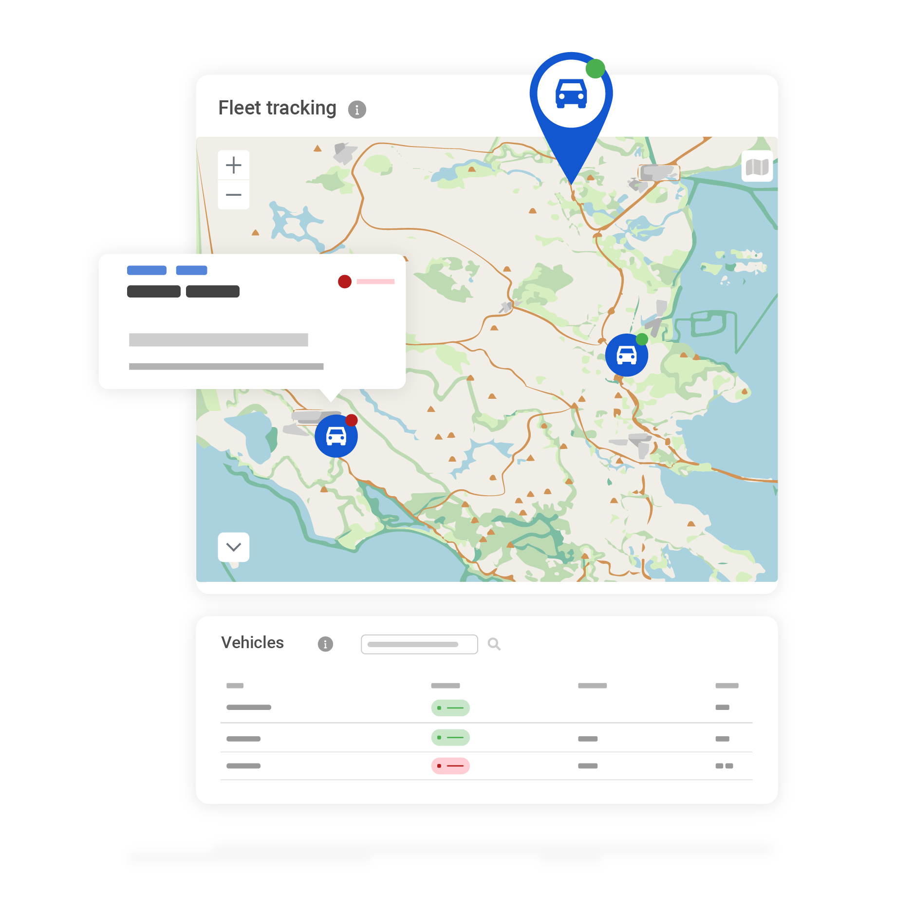
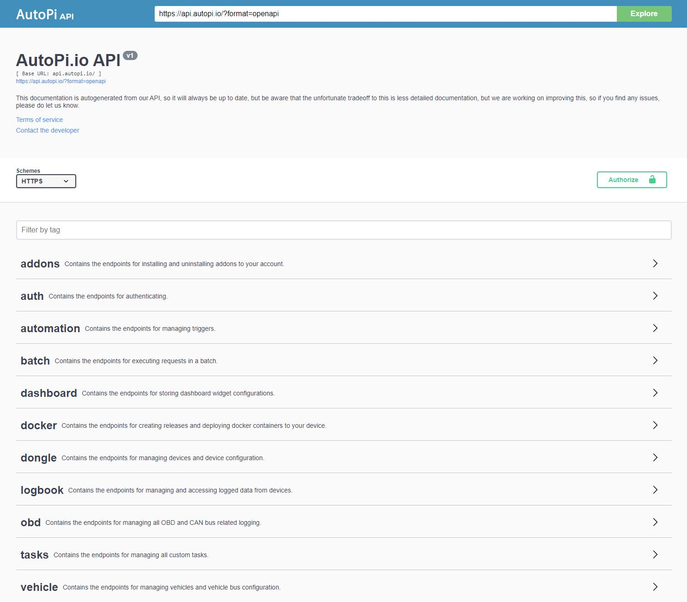

# Introduction

> AutoPi Cloud is the central platform for managing AutoPi devices, configuring data collection, and working with vehicle and fleet data. Use it to monitor deployments, apply configuration changes remotely, investigate events and diagnostics, and integrate AutoPi data with your own systems.

AutoPi Cloud is the central platform for managing AutoPi devices, configuring data collection, and working with vehicle and fleet data. Use it to monitor deployments, apply configuration changes remotely, investigate events and diagnostics, and integrate AutoPi data with your own systems.

  

## What You Can Do in AutoPi Cloud

AutoPi Cloud is organized around the operational tasks below.

  

### Device Management

Use **Device Management** to monitor device connectivity, alerts, and software status. From an individual device, you can:

- Configure [loggers](https://docs.autopi.io/cloud/device_management/device-loggers/), [services](https://docs.autopi.io/cloud/device_management/services/), [events](https://docs.autopi.io/cloud/device_management/events/), and [advanced device settings](https://docs.autopi.io/cloud/device_management/advanced_settings/autopi_tmu_cm4/).
- Deploy [custom code](https://docs.autopi.io/cloud/device_management/custom-code/) and create [triggers](https://docs.autopi.io/cloud/device_management/a-guide-to-triggers/) for event-driven automation.
- Run remote [commands](https://docs.autopi.io/core/commands/) and [jobs](https://docs.autopi.io/cloud/device_management/cloud-jobs/).
- Deploy [software updates](https://docs.autopi.io/cloud/device_management/software-updates/) and review configuration changes.
- Create [templates](https://docs.autopi.io/cloud/device_management/templates/) to apply consistent configurations across multiple devices.
- Inspect incoming data and troubleshoot device behavior.

Start with the [Device Management overview](/cloud/device_management/).

### Fleet Management

Use **Fleet Management** to turn data from your devices into an operational view of your vehicles. You can:

- View vehicle [locations](https://docs.autopi.io/cloud/fleet_management/locations), status, telemetry, and [trips](/cloud/fleet_management/vehicles/trips/).
- Organize vehicles into [groups](https://docs.autopi.io/cloud/fleet_management/vehicles/fleet-groups/) and [locations](https://docs.autopi.io/cloud/fleet_management/locations/).
- Configure [geofences](https://docs.autopi.io/cloud/fleet_management/vehicles/fleet-geofences/), [alerts](https://docs.autopi.io/cloud/fleet_management/fleet-alerts/), [dashboards](https://docs.autopi.io/cloud/fleet_management/configurations/dashboards/), [fault codes](https://docs.autopi.io/cloud/fleet_management/configurations/fault-codes/), and [notification channels](https://docs.autopi.io/cloud/fleet_management/configurations/notification-channels/).
- Define [asset types](https://docs.autopi.io/cloud/fleet_management/configurations/asset-types/) and review RFID activity through [Access Control](https://docs.autopi.io/cloud/fleet_management/access-control/).
- Review [diagnostics](https://docs.autopi.io/cloud/fleet_management/fleet-diagnostics/) and generate [reports](https://docs.autopi.io/cloud/fleet_management/reports/) for fleet activity and utilization.

Start with the [Fleet Management introduction](/cloud/fleet_management/).

### Account Management

Use **Accounts** to manage customers, users, devices, permissions, and API tokens. Nested customers and permission groups help separate data and responsibilities across teams, business units, or customers.

See [Accounts](/cloud/accounts/) for the account structure and access options.

### API

The AutoPi REST API lets you automate supported Cloud workflows and connect AutoPi with your own applications. Depending on the endpoint, you can retrieve telemetry and trip data, manage device settings, execute commands, and build data export workflows.

See [Getting Started with the REST API](/getting_started/api/) for authentication and examples, or use the [interactive API reference](https://api.autopi.io/) for endpoint details.

## Where to Start

Choose the area that matches your task:

[ **Device Management** Configure, monitor, update, and troubleshoot your AutoPi devices.](/cloud/device_management/)

[ **Fleet Management** Track vehicles, review trips and diagnostics, and manage fleet workflows.](/cloud/fleet_management/)

[ **REST API** Authenticate, explore endpoints, and integrate AutoPi data with your systems.](/getting_started/api/)

[ **Accounts** Manage customers, users, permissions, devices, and API tokens.](/cloud/accounts/)
