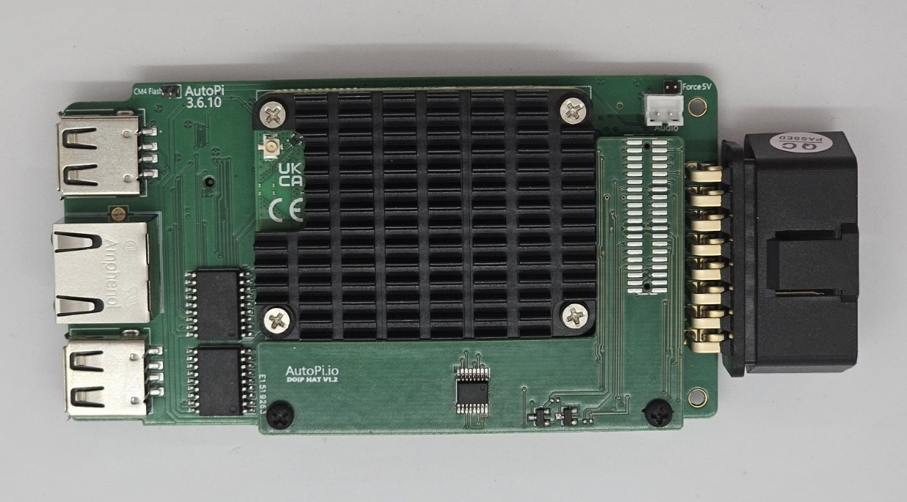
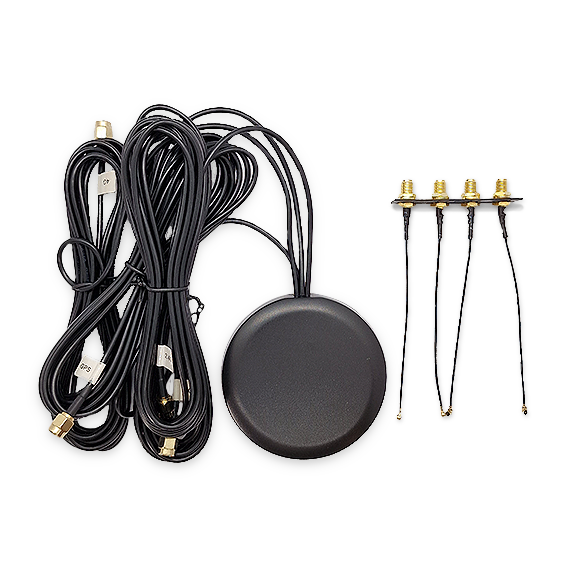
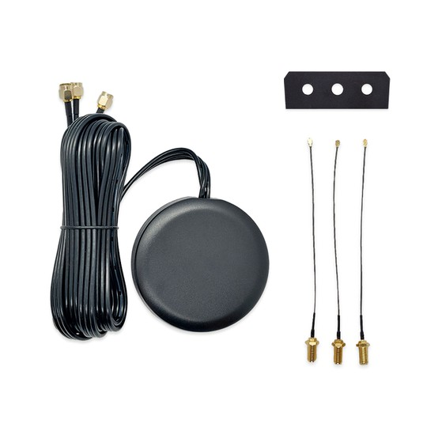
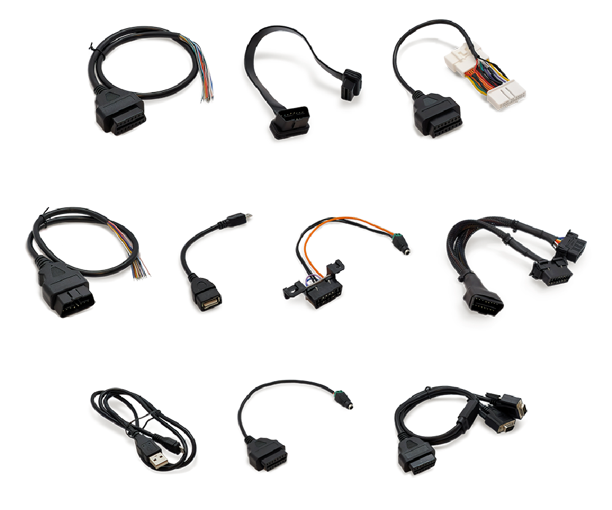
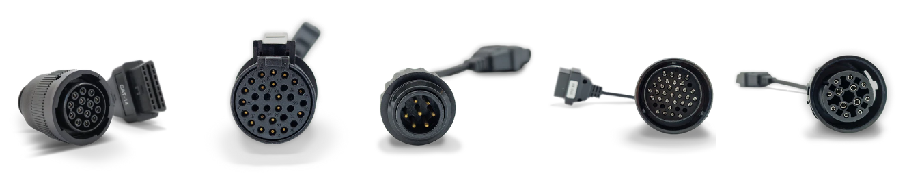
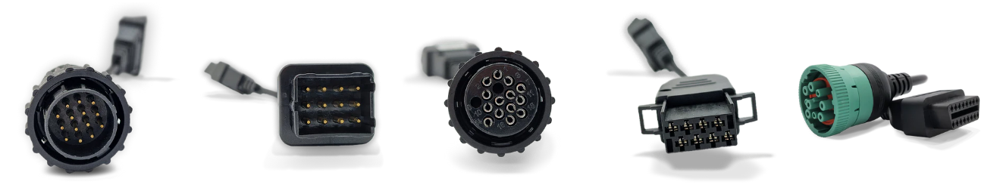

import DeviceSupportBanner from '@site/src/components/DeviceSupportBanner';

<DeviceSupportBanner supported={frontMatter.supportedDevices} />
---

This section covers accessories for extending, installing, and connecting AutoPi devices. Use the links below to review compatibility, installation instructions, and connector pinouts before adding an accessory to your setup.

:::info Need a custom integration?
[Contact the AutoPi team](mailto:support@autopi.io) to discuss requirements that are not covered by the standard accessories in this section.
:::

## Global SIM Card

The [Global SIM Card Solution](/hardware/accessories/sim-solution/) provides cellular coverage in 188 countries. The guide lists the supported countries and network operators.

The AutoPi Mini and TMU CM4 devices purchased with a subscription already include a SIM card. For other configurations, select a data plan from the [AutoPi Shop](https://shop.autopi.io/products/global-sim-card-solution). Monthly data usage is available in [AutoPi Cloud](https://my.autopi.io).

## DoIP HAT

The DoIP HAT adds Diagnostics over Internet Protocol (ISO 13400) support to compatible AutoPi TMU CM4-based devices. It supports Ethernet-based vehicle diagnostics, including UDS communication and ECU programming workflows.

:::caution Check vehicle compatibility
Install a DoIP-enabled device only in a vehicle that supports Ethernet diagnostics. After installation, the AutoPi Ethernet interface is routed internally to the vehicle and must not be connected to an external Ethernet device.
:::

- Follow the [DoIP HAT installation guide](/hardware/accessories/doip-install/).
- Complete the [DoIP software setup](/developer_guides/setting-up-doip/).
- Purchase the [DoIP HAT for AutoPi TMU CM4](https://shop.autopi.io/products/doip-hat-v1-3).

  

## External Antenna Kits

External antenna kits can improve reception when a device is installed where its internal antennas have limited access to cellular, GNSS, or Wi-Fi signals. Both kits can be ordered pre-installed or installed on a compatible TMU CM4.

### 4-in-1 Antenna Kit

The [4-in-1 Antenna Kit](https://shop.autopi.io/products/4-in-1-car-antenna-lte-x2-gps-wifi) includes two LTE antennas, one GNSS antenna, and one Wi-Fi antenna. Follow the [4-in-1 installation guide](/hardware/autopi_tmu_cm4/installing_4in1_external_antennas/) when adding the kit to a TMU CM4.

:::note
The AutoPi CAN-FD Pro includes the 4-in-1 antenna kit as standard.
:::

  

### 3-in-1 Antenna Kit

The [3-in-1 Antenna Kit](https://shop.autopi.io/products/3in1-external-antenna-kit) includes two LTE antennas and one GNSS antenna. Follow the [3-in-1 installation guide](/hardware/autopi_tmu_cm4/installing_external_antennas/) when adding the kit to a TMU CM4.

  

## General-Purpose Cables

The following cables support common installation, development, and testing scenarios:

- [OBD-II Extension Cable](https://shop.autopi.io/products/obd-ii-extension-cable): Relocates the device using a direct pass-through connection on all 16 pins.
- [OBD-II Power Cable](https://shop.autopi.io/products/obd-ii-power-cable): Powers a device from a 12-24 V DC supply for setup, testing, or development outside a vehicle.
- [OBD-II Splitter Cable](https://shop.autopi.io/products/obd-ii-splitter-cable): Connects an AutoPi and a second OBD-II device while keeping both ports available.
- [OBD-II to Dual DB9 Cable](/hardware/accessories/dualdb9-pinout/): Connects two CAN bus channels from an AutoPi TMU CM4 or AutoPi CAN-FD Pro to separate DB9 connectors. [Purchase the cable](https://shop.autopi.io/products/obd2-to-dual-db9).
- [Tesla OBD-II Adapter Cable for Model 3 and Y](/hardware/accessories/tesla-obd2-adapter-model-3-y/): Adds an OBD-II connection to a compatible Tesla Model 3 or Model Y.
- [Micro USB to USB-A Adapter Cable](https://shop.autopi.io/products/micro-usb-to-usb-a-adapter-cable): Connects a USB-A peripheral to the Micro USB port on an AutoPi Telematics Unit.
- [CAN Bus Testing/Loop Cable](https://shop.autopi.io/products/can-bus-testing-cable): Loops the two CAN interfaces on an AutoPi TMU CM4 for communication testing.
- [Male CAN Bus Cable with Open Wires](/hardware/accessories/male-can-bus-open-wires/): Exposes individual signals for a custom installation.
- [Female CAN Bus Cable with Open Wires](/hardware/accessories/female-can-bus-open-wires/): Provides a female OBD-II connector with individual wires for custom connections.

  

## Heavy-Duty Vehicle Adapter Cables

Vehicle-specific adapter cables connect an AutoPi OBD-II interface to J1939 or J1708 diagnostic connectors. Select the guide that matches the connector and vehicle. Each guide includes a pinout and a link to the corresponding cable.

- [Caterpillar 14-pin J1939 adapter](/hardware/accessories/caterpillar-14pin-j1939-obd2/)
- [Caterpillar 538-5051 9-pin J1939 adapter](/hardware/accessories/caterpillar-538-5051-9pin-j1939-obd2/)
- [Cummins 9-pin J1939/J1708 adapter](/hardware/accessories/cummins-9pin-j1939-obd2/)
- [Cummins-Komatsu 12-pin J1939 adapter](/hardware/accessories/cummins-komatsu-12pin-j1939-obd2/)
- [IVECO 30-pin J1939 adapter](/hardware/accessories/iveco-30pin-j1939-obd2/)
- [Knorr Wabco trailer 7-pin J1939 adapter](/hardware/accessories/knorr-wabco-7pin-j1939-obd2/)
- [MAN 37-pin J1939 adapter](/hardware/accessories/man-37pin-j1939-obd2/)
- [MAN truck 12-pin J1939 adapter](/hardware/accessories/man-truck-12pin-j1939-obd2/)
- [Mercedes 14-pin J1939 adapter](/hardware/accessories/mercedes-14pin-j1939-obd2/)
- [Renault 12-pin J1939 adapter](/hardware/accessories/renault-12pin-j1939-obd2/)
- [Scania 16-pin J1939 adapter](/hardware/accessories/scania-16pin-j1939-obd2/)
- [Volvo 8-pin J1939 adapter](/hardware/accessories/volvo-8pin-j1939-obd2/)

## Device Mounts

The [Device Mounts guide](/hardware/accessories/device_mounts/) provides downloadable 3D-printable designs for mounting a compatible AutoPi device on a flat or curved surface.