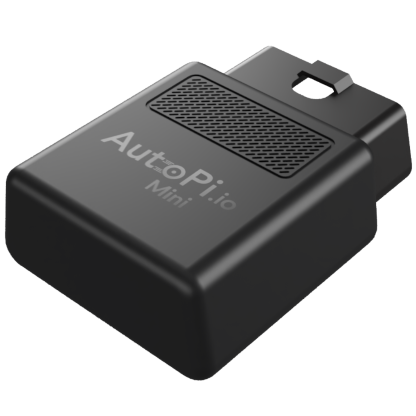
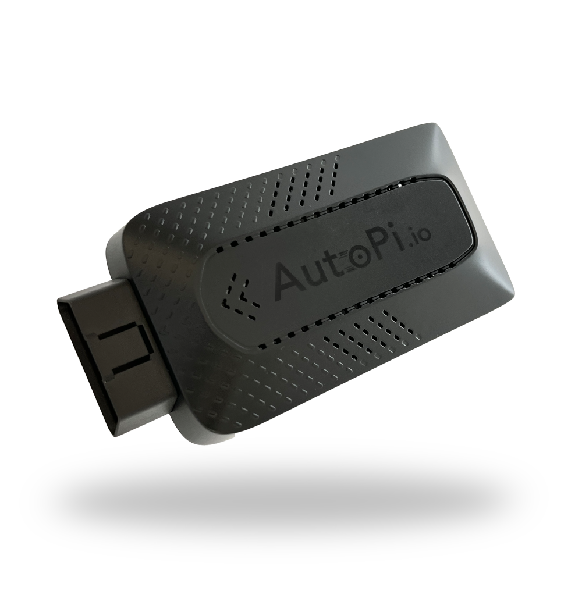
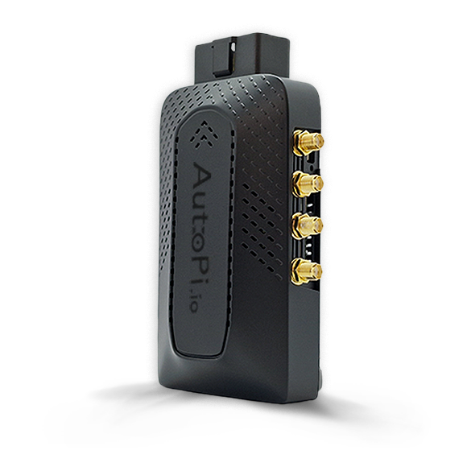
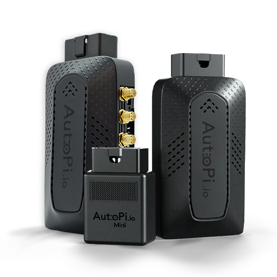

import useBaseUrl from '@docusaurus/useBaseUrl';
import SideBySide from '@site/src/components/SideBySide';
import CardGrid from "/components/CardGrid";

This section contains hardware documentation for current and legacy AutoPi devices, along with supported accessories and
adapter cables. Use it to identify connectors, review technical specifications, plan an installation, or find information
specific to your device model.

## What You Will Find Here

The available documentation varies by device, but generally covers:

- Device dimensions and technical specifications.
- Connector and pinout references.
- LED and button states.
- Mounting and antenna installation.
- Replaceable components and hardware expansion options.
- Accessories, cables, and vehicle-specific adapters.
- Reference material for legacy devices.

For initial installation and Cloud setup, select your device from the **Getting Started** category in the sidebar. For device
configuration and data management, see the [Cloud documentation](/cloud/). This section focuses on the physical device and
its connections.

## Choose Your Device

Select your device model to find the relevant hardware documentation.

  

<CardGrid home>

[ **AutoPi Mini** View specifications and the OBD-II connector pinout for the compact, plug-and-play fleet device.](/hardware/autopi_mini/autopi-mini-intro/)

[ **AutoPi TMU CM4** Find dimensions, specifications, connector details, mounting information, and hardware expansion guides.](/hardware/autopi_tmu_cm4/autopi-cm4-intro/)

[ **AutoPi CAN-FD Pro** Review specifications, dimensions, mounting options, indicators, and connector pinouts.](/hardware/autopi_canfd_pro/autopi-pro-intro/)

[ **AutoPi CAN-FD Pro with IP67 casing** Find mounting instructions and pinouts for the protected CAN-FD Pro enclosure.](/hardware/autopi_canfd_pro_casing/autopi-pro-casing-intro/)

</CardGrid>

Looking for an earlier model? See the **Legacy Devices** category in the sidebar. For cables, mounts, antennas, and other
supported hardware, see [Accessories](/hardware/accessories/accessories-intro/).

## General Installation Guidance

Always follow the model-specific installation and connector documentation. The following guidance applies to most AutoPi
installations.

<SideBySide>
	

		<strong>Avoid direct sunlight. </strong>Install the device away from direct sunlight and other heat sources. Excessive
		heat can reduce performance and may cause the processor to throttle.
	

	
</SideBySide>

 

<SideBySide>
	

		<strong>Keep the GNSS antenna clear. </strong>Do not place metal directly over a device with an internal GNSS antenna.
		Metal can obstruct satellite signals and reduce positioning accuracy.
	

	
</SideBySide>

 

<SideBySide>
	

		<strong>Use the correct orientation. </strong>For devices with an internal GNSS antenna near the logo, position the
		logo side toward the sky whenever possible. Check your device guide for its antenna location.
	

	
</SideBySide>

 

<SideBySide>
	

		<strong>Use the designated power input. </strong>Power the device only through the connector and cable specified in its
		hardware guide. Do not attempt to power it through data or expansion ports.
	

	
</SideBySide>

