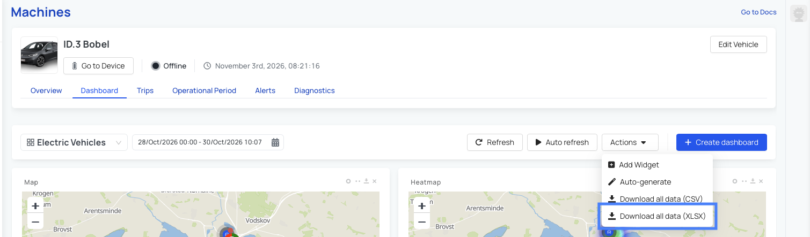
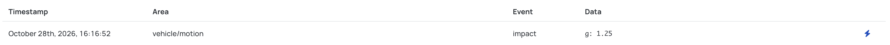

# November 2026

> <DeviceSupportBanner supported={frontMatter.supportedDevices} />

---

## New Features

### XLSX Data Export

*Where to find it: Vehicle or Device -> Dashboard -> Actions -> Download All Data (XLSX)*

You can now export data in XLSX format in addition to CSV. Choose the format that best suits your reporting and analysis workflow when downloading data from a vehicle or device dashboard.

### Impact Detection Event

*Where to find it: Device -> Events*

Impact detection is a new event that can notify you when a device detects a significant impact. This can help you identify when a vehicle may have been involved in an accident so that you can investigate and respond quickly.

The impact detection settings are available on devices running version `1.28.6` or later. This ensures that the available configuration options match the capabilities of the device.

## Bug Fixes

- When creating a PGN in the OBD library, it was not possible to associate it with a CAN bus. PGNs can now be associated with a CAN bus as expected.
- The OBD library search did not always return results that matched the specified input. Search results now reflect the entered search criteria correctly.
- The Device Metrics widget displayed an error when data could not be retrieved from a device that had been offline for an extended period. The widget now handles unavailable data without displaying an error.
- AutoPi Mini devices did not always display the correct driving state. Driving state detection has been improved to provide more accurate status information.

---

For a full list of all changes, see the [**November 2026 Changelog**](/changelog/november-2026).
